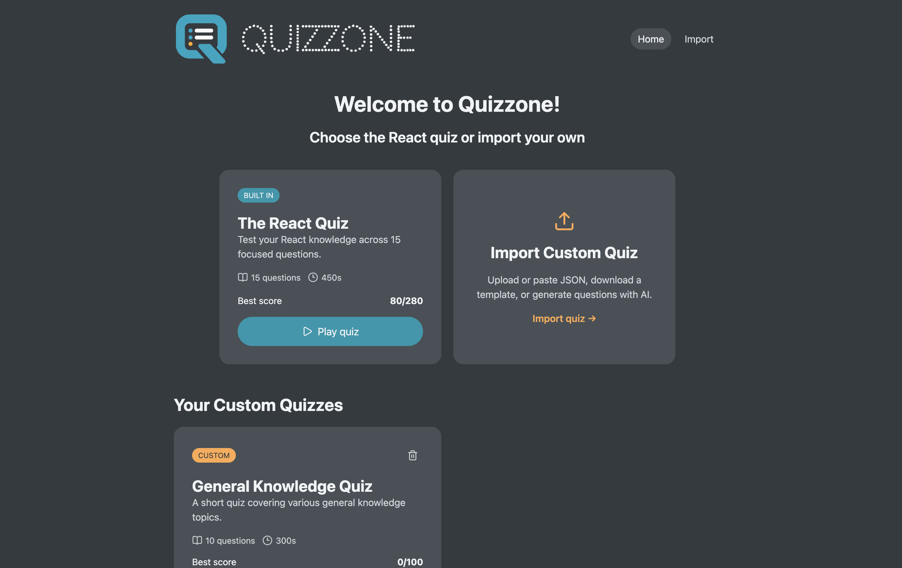

# Quizzone



Quizzone is a customizable quiz application for learning, practice, and self-assessment. Play the included React quiz, build a personal quiz library from JSON files, or turn lesson material into a quiz with AI.

## Table of contents

- [Live preview](#live-preview)
- [Features](#features)
- [How it works](#how-it-works)
- [AI quiz generation](#ai-quiz-generation)
- [Tech stack](#tech-stack)
- [Getting started](#getting-started)
- [Available scripts](#available-scripts)
- [License](#license)

## Live preview

[Open Quizzone](https://quizzone.vivianaein.dev)

The live application is hosted on Cloudflare.

## Features

- Play the included React knowledge quiz.
- Import custom quizzes by uploading or pasting JSON.
- Download a ready-to-edit quiz template.
- Preview imported questions before saving them.
- Generate quizzes directly from lesson notes with Groq AI.
- Prepare quiz prompts for ChatGPT, Claude, or Gemini.
- Save custom quizzes in a personal quiz library.
- Track a separate high score for every quiz.
- Keep quizzes and high scores after refreshing the browser.
- Delete custom quizzes with an animated confirmation dialog.
- Use the application comfortably across desktop and mobile screens.

## How it works

The home page displays the built-in React quiz and every custom quiz saved by the user. Each quiz card shows its question count, estimated duration, and best score.

The Import page provides three ways to create a custom quiz:

1. Upload a prepared JSON quiz.
2. Download the template, add questions, and import it later.
3. Generate quiz content with AI.

Quizzone previews imported or generated questions before adding them to the library. Saved quizzes remain available in the same browser, and each quiz keeps its own high score.

## AI quiz generation

Quizzone offers two AI workflows:

- **Generate here:** paste lesson notes, choose the number of questions, and let Groq create the quiz inside Quizzone.
- **Use an AI assistant:** create a prepared prompt for ChatGPT, Claude, or Gemini. Paste lesson text in the prompt or attach a PDF in the selected assistant, then return the generated JSON to Quizzone for preview and saving.

Create a Groq API key from the [Groq API Keys page](https://console.groq.com/keys) to use direct generation.

## Tech stack

| Technology | How it is used |
| --- | --- |
| React | Builds the quiz library, quiz player, import flow, and interactive dialogs. |
| TypeScript | Adds type safety to quizzes, application state, forms, and reusable components. |
| Vite | Runs the local development server and creates the production build. |
| React Router | Handles the library, import, quiz, and not-found pages. |
| Context API and `useReducer` | Manages the quiz library, active quiz session, scores, and actions. |
| React Hook Form | Manages the JSON import and AI generator forms. |
| Zod | Validates imported quizzes, saved browser data, and AI responses. |
| AI SDK and Groq | Generate structured multiple-choice quizzes from lesson material. |
| Local Storage | Preserves custom quizzes and individual high scores between visits. |

## Getting started

Clone the project and install its dependencies:

```bash
git clone git@github.com:naked-vivi/react-quiz.git
cd react-quiz
npm install
```

Copy the example environment file and add your Groq API key if you want to use direct AI generation:

```bash
cp .env.example .env
```

Start the application:

```bash
npm run dev
```

Open [http://localhost:4000](http://localhost:4000) in your browser.

## Available scripts

| Command | Purpose |
| --- | --- |
| `npm run dev` | Start the local development server. |
| `npm run build` | Type-check and create a production build. |
| `npm run preview` | Preview the production build locally. |
| `npm run lint` | Check the project with ESLint. |
| `npm run typecheck` | Run TypeScript checks without building. |

## License

[MIT](./LICENSE)
